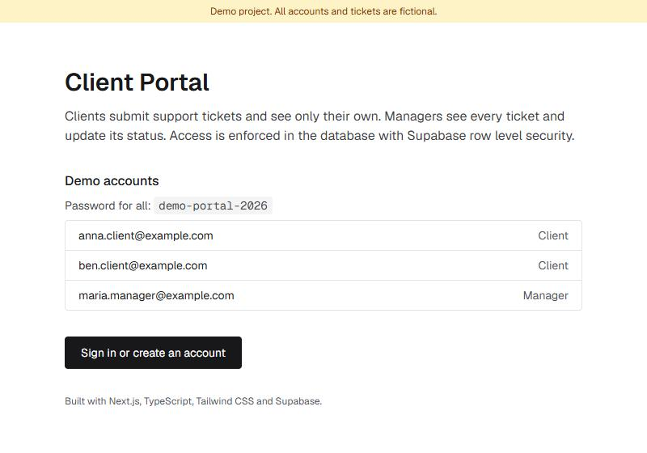
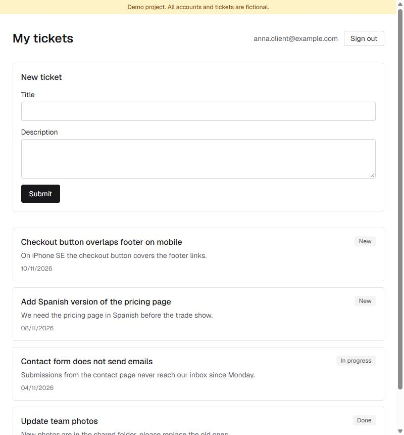
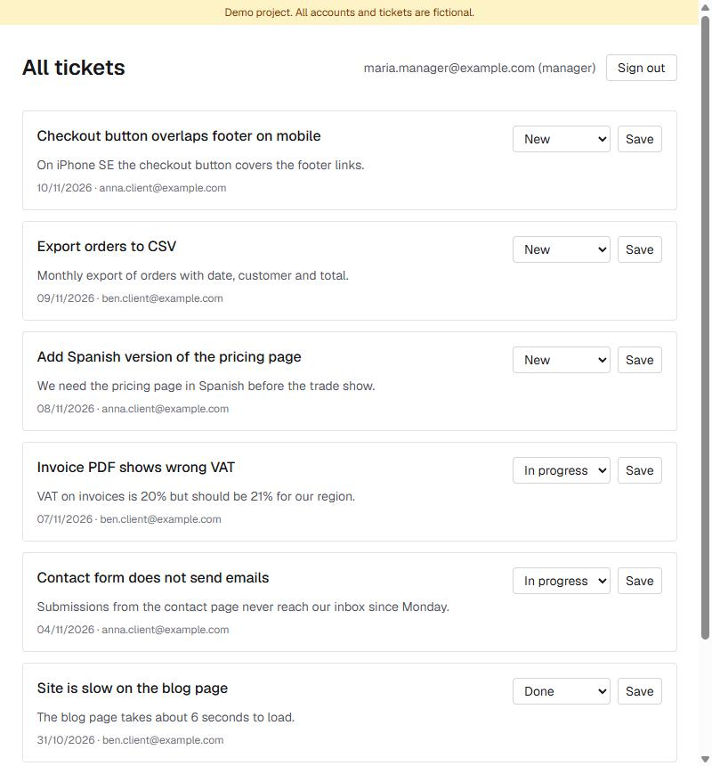

# Client Portal Demo

A small client portal built with Next.js and Supabase. Clients submit support tickets and see only their own. Managers see every ticket and change its status.

This is a demo project. All accounts and tickets are fictional.



| Client view | Manager view |
| --- | --- |
|  |  |

## Features

- Sign up, sign in and sign out with email and password (Supabase Auth)
- Clients create tickets and see a list of their own tickets
- Managers see all tickets with the client's email and update the status: New, In progress, Done
- Protected routes: signed-out users are redirected to the login page

## Stack

Next.js 16 (App Router, Server Actions), TypeScript, Tailwind CSS 4, Supabase (Postgres, Auth, Row Level Security).

## How access is enforced

Access rules live in the database, not in the UI. The app talks to Supabase only with the public anon key, so even a direct API call cannot get around them.

- Row Level Security on `tickets`: a client reads and inserts only rows where `owner_id` is their own id. A manager reads all rows.
- Column grants: clients can send only `title` and `description`. `owner_id` and `status` come from column defaults.
- Only `status` can be updated, and only managers pass the update policy. Nobody can delete tickets.
- Roles are stored in `profiles`. Users cannot change their own role; new accounts always start as clients.

The service_role key is not used anywhere in this project.

`tests/rls.test.mjs` checks these rules through the public API with the seed accounts: a client cannot read another client's tickets, cannot change a status, cannot create a ticket for someone else, and cannot promote themselves.

## Demo accounts

Password for all: `demo-portal-2026`

| Email | Role |
| --- | --- |
| anna.client@example.com | Client |
| ben.client@example.com | Client |
| maria.manager@example.com | Manager |

## Run locally

Requirements: Node.js 20+, Docker (for the local Supabase stack).

```bash
npm install
npx supabase start
cp .env.example .env.local
```

Put the `API URL` and `anon key` printed by `npx supabase status` into `.env.local`, then:

```bash
npx supabase db reset   # applies migrations and seed data
npm run dev
npm run test:rls        # run against a freshly seeded database
```

## Deploy

1. Create a Supabase project. In Authentication > Sign In / Providers > Email, turn off "Confirm email" so demo sign-ups work without email.
2. Apply the schema and demo data:
   ```bash
   npx supabase link --project-ref <your-project-ref>
   npx supabase db push --include-seed
   ```
3. Import the repository in Vercel and set two environment variables from Supabase > Project Settings > API: `NEXT_PUBLIC_SUPABASE_URL` and `NEXT_PUBLIC_SUPABASE_ANON_KEY`.

## Project structure

```
app/
  page.tsx            landing page with demo accounts
  login/              sign in / sign up page and auth actions
  tickets/            ticket list, create form, status updates
lib/supabase/server.ts  Supabase client for Server Components and Actions
proxy.ts              refreshes the session, guards /tickets
supabase/migrations/  tables, signup trigger, RLS policies
supabase/seed.sql     fictional demo data
tests/rls.test.mjs    access rules test
```
